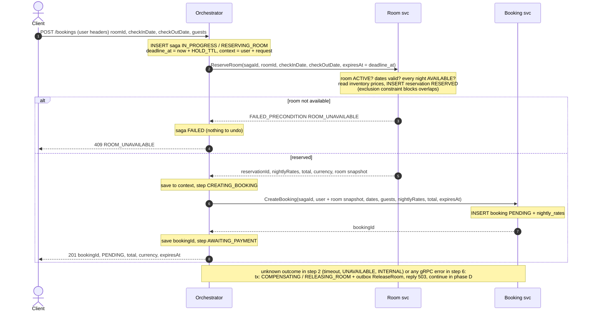
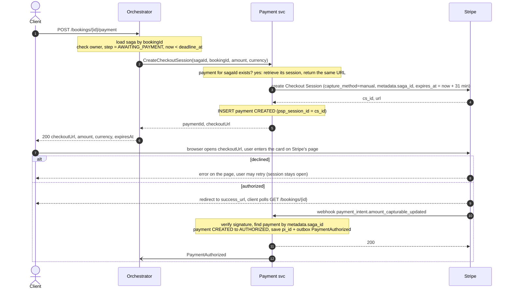
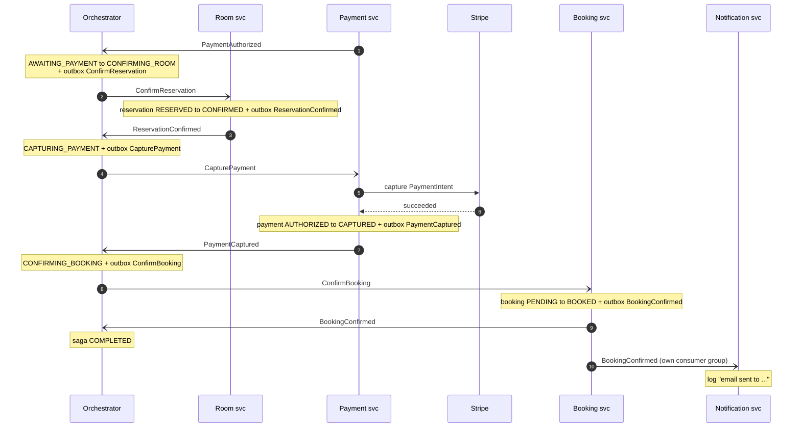
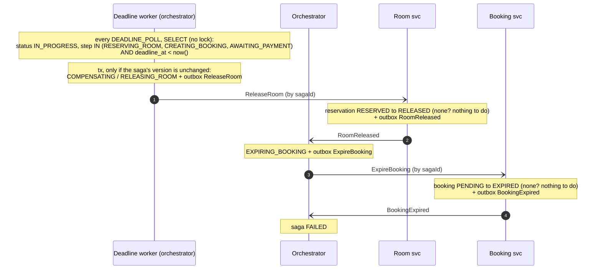
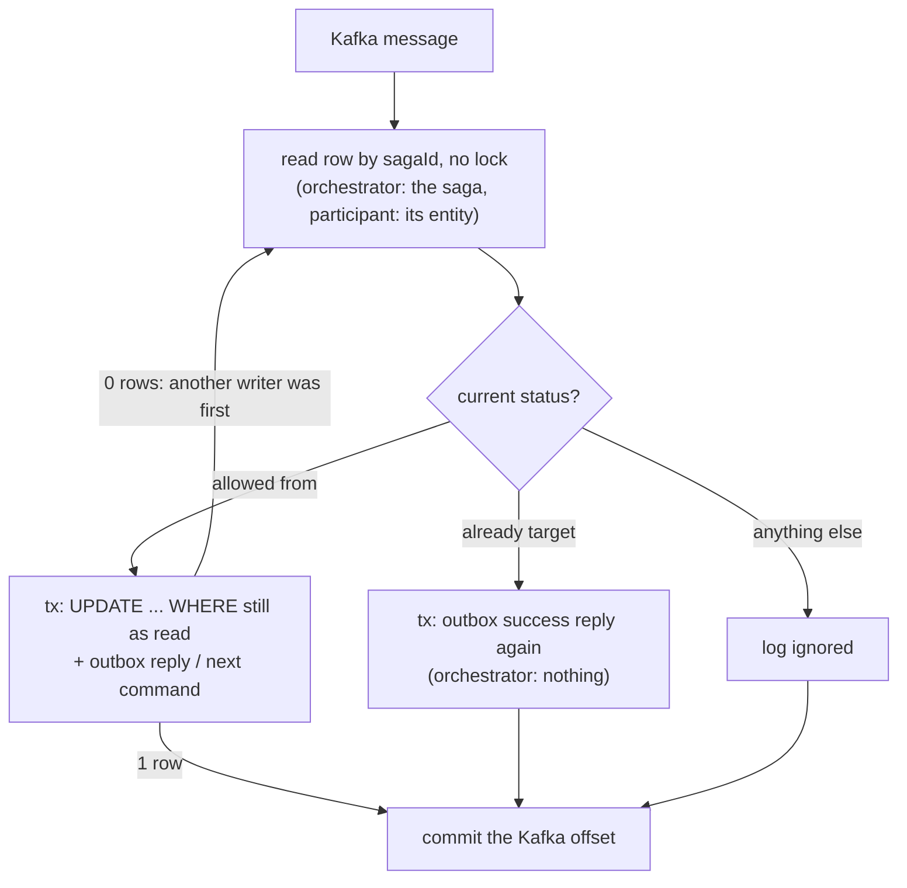

# UC1 flows (v1)

Legend:
- `->>` sync call (REST / gRPC / Stripe API), `-->>` its response
- `-)` async message via **Kafka**, always written to the sender's **outbox** in the same transaction as the state change (Kafka isn't drawn)
- `Note` = what happens inside one DB transaction

---

## Phase A: hold room and create booking (sync)

`ReserveRoom` errors come in two kinds:
- **Definite rejection** (`NOT_FOUND`, `INVALID_ARGUMENT`, `FAILED_PRECONDITION`): nothing was held, so the saga goes to `FAILED` and the client gets `404` / `400` / `409`. The diagram shows `ROOM_UNAVAILABLE` as the example.
- **Unknown outcome** (timeout, `UNAVAILABLE`, `INTERNAL`): a hold may exist, so the saga goes to phase D and the client gets `503`.

Any `CreateBooking` error goes to phase D, because the room is already held.

`ReserveRoom` itself checks the room (it exists and is `ACTIVE`), the dates (check-in before check-out, not in the past) and the inventory of every night. It is idempotent by `saga_id`: a repeated call returns the stored hold and its prices.

Each `Note` over O is its own short transaction, and no transaction stays open during a gRPC call. If the orchestrator crashes mid-phase, the saga keeps its `deadline_at`, so the **deadline worker** releases whatever was held (phase D).

---

## Phase B: pay

- **Hosted page, not an embedded form.** The user pays on Stripe's own page (a Checkout Session). Our services only pass a URL, and no `client_secret` or card data goes through them.
- Session parameters: `mode=payment`, cards only (`allowed_payment_method_types=card`, or `payment_method_types=card` if your stripe-go version doesn't have it; without it the page offers every method enabled in the Stripe dashboard), one line item (`amount`, `currency`, and a required product name such as `Booking <bookingId>`), `payment_intent_data.capture_method=manual`, `payment_intent_data.metadata.saga_id`, `success_url` from config (`STRIPE_SUCCESS_URL`, with `{BOOKING_ID}` replaced), and `expires_at` = now + 31 min (Stripe's minimum is 30 min; 1 min spare for clock difference). v1 sets no `cancel_url`.
- **No fixed `Idempotency-Key`.** Stripe saves the first answer per key, a 5xx included, and returns it again for 24 h or more, so a retry with that key can never succeed; and the same key with another `expires_at` is rejected. A session whose answer was lost was never shown to the user and expires by itself. `payments.saga_id UNIQUE` keeps one row per saga: if two calls arrive at once, the second insert conflicts and returns the stored row's session.
- Stripe creates the PaymentIntent only when the user submits the card. So the payment row starts with a session ID and no intent ID; the webhook finds the row through `metadata.saga_id` and saves the `pi_…` ID that `CapturePayment` needs.
- A repeated call (page refresh, user comes back) retrieves the session from Stripe by `psp_session_id` and returns its URL again, so we store IDs only. Stripe only returns a URL while the session is open. If there is none (the user already paid, even when the webhook hasn't arrived yet), Payment answers `FAILED_PRECONDITION` and the orchestrator replies `409 BOOKING_NOT_PAYABLE`.
- A failed `CreateCheckoutSession` never moves the saga: the client gets `503` (Stripe down, timeout) or `409`, the saga stays in `AWAITING_PAYMENT`, and the client may call again until the deadline. Only phase A errors go to phase D.
- The session isn't tied to `deadline_at`: it expires 31 min after its own creation, so it can stay open after the hold expired. A payment made after the release is voided (see phase C and E5).
- Locally, `stripe listen --latest --forward-to localhost:<port>/payments/api/v1/webhooks/stripe` delivers webhooks and prints the signing secret. `--latest` matters: stripe-go rejects an event whose API version differs from the SDK's.
- A duplicate webhook finds the payment already `AUTHORIZED` → return 200 and do nothing (rule 3). An event without our `saga_id` (for example from `stripe trigger`) also gets 200 and is ignored.

---

## Phase C: confirm → capture → book → notify

- Order: **room first** (make sure we have it), **then take the money**, **then** mark the booking.
- `ConfirmReservation` can't fail in v1: only the orchestrator releases holds, and it can't be releasing and confirming the same saga at once (every saga write is guarded by its `version`).
- If Stripe rejects the capture, Payment replies `PaymentCaptureFailed`, and the orchestrator marks the saga FAILED and logs it for a manual fix (automatic handling = G10). Only a definite refusal counts: HTTP 400 / 402 / 404 and the PaymentIntent is not `succeeded`. A timeout, 429 or 5xx is an error the consumer loop retries.
- A repeated capture needs no idempotency key: a PaymentIntent can be captured only once, and when Stripe refuses a second capture the PaymentIntent's status `succeeded` means "already captured".
- If `PaymentAuthorized` arrives after the release (the saga is in `RELEASING_ROOM` or `EXPIRING_BOOKING`, also when already `FAILED` there), it is never captured: the orchestrator sends `CancelPayment`, and Payment voids the authorization (`AUTHORIZED` → `CANCELLED`). There is no reply and no saga step.

---

## Phase D: release (deadline or phase A error)

Both commands are looked up **by `sagaId`**, and "no row" is a valid success. That's why one path covers every case: timeout, a crash in phase A, or a gRPC timeout where we don't know whether the reservation or booking was created.

---

## Shape of every message handler

- **Conditional update, no row lock.** "Still as read" is `status = <from>` for a participant and `version = <the version read>` for the saga (then `version + 1`). The update and its outbox row are one transaction inside one repository method. If 0 rows change, the handler returns an error and the consumer loop calls it again from the read.
- **Commit the offset after the DB commit.** A crash between the two means the message comes again, and the status check turns the duplicate into a no-op.
- **A failed handler is called again with the same record** (wait 1 s, doubling up to 30 s). Not committing is not a retry: the client would simply hand over the next record. An error no retry can fix (bad JSON, unknown type, saga not found) is logged and skipped.
- **No row** is a normal case for the release commands: `ReleaseRoom` and `ExpireBooking` reply success with a null ID. For the confirm commands it is only logged.
- Handlers that call Stripe (`CapturePayment`, `CancelPayment`) check the status first, call Stripe **outside** any transaction, then do the write above.
