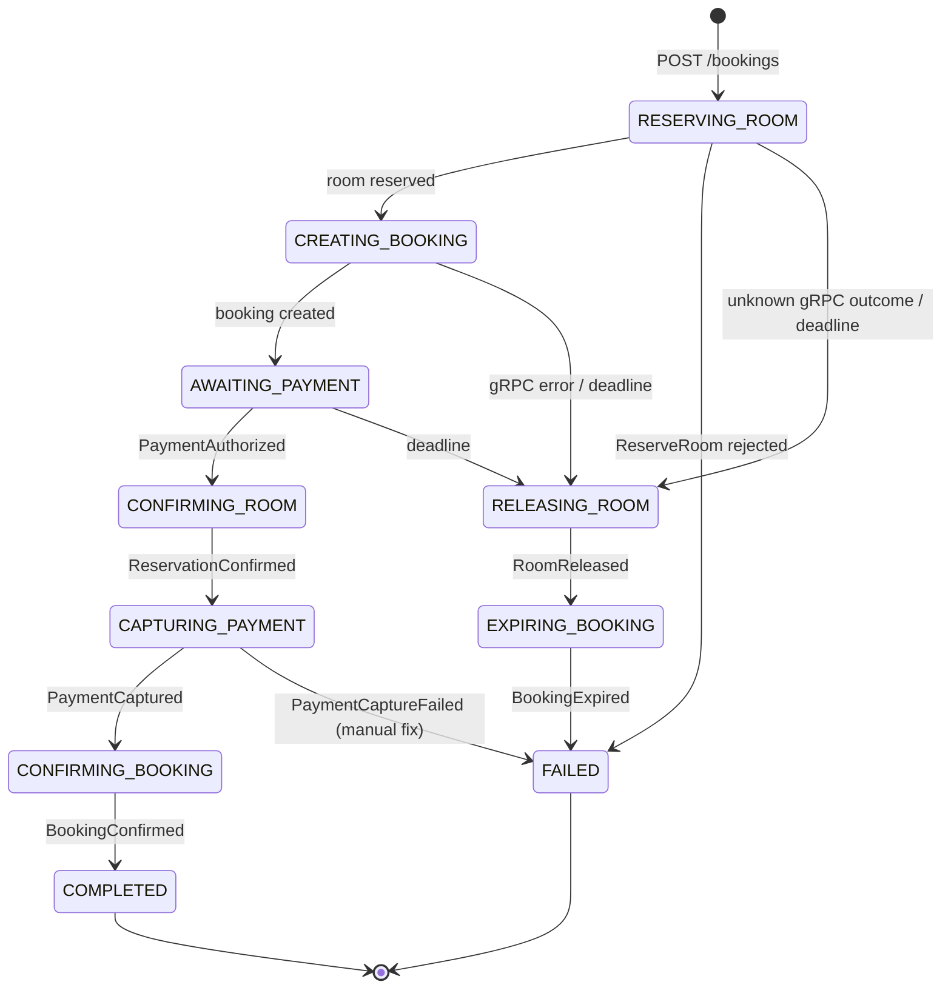
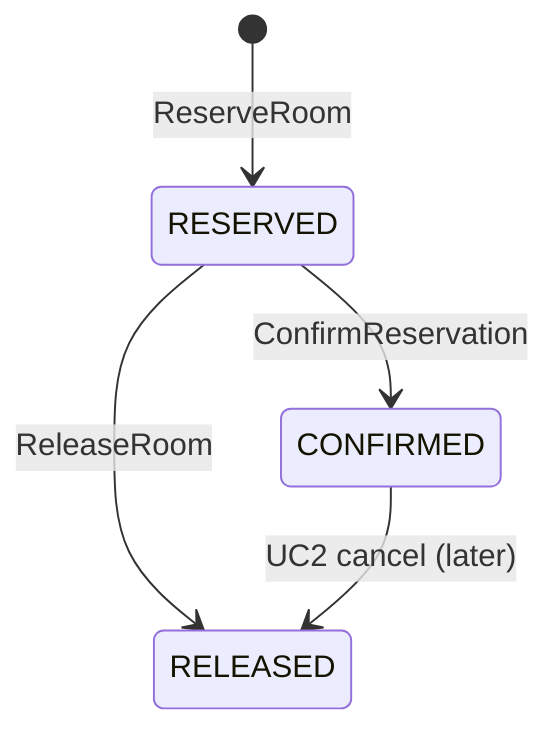
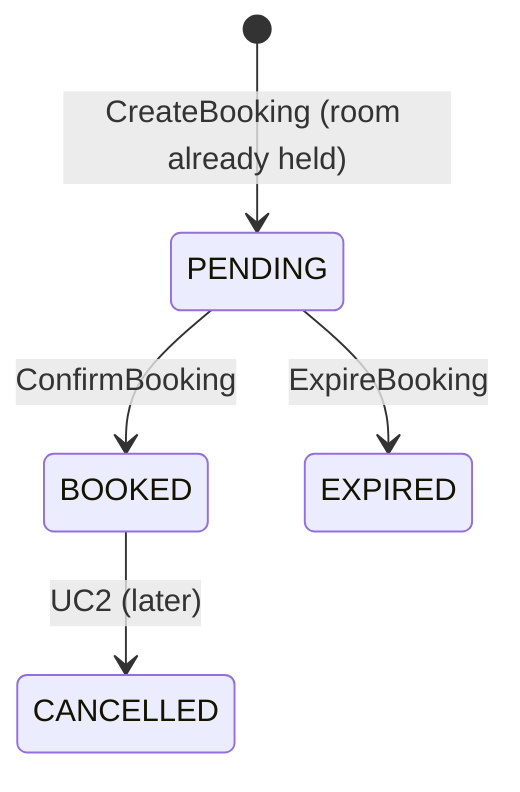
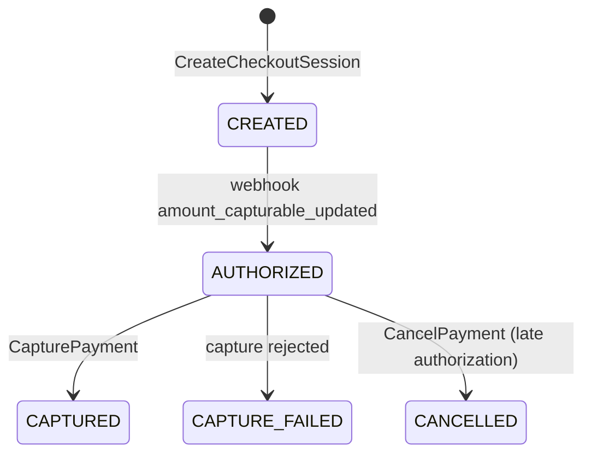

# UC1 state machines (v1)

Only the **saga** knows the whole flow. Each entity only knows its own legal transitions.

## Saga

Owned by the orchestrator (`saga_instances`).

| `status` | steps |
|---|---|
| `IN_PROGRESS` | `RESERVING_ROOM`, `CREATING_BOOKING`, `AWAITING_PAYMENT`, `CONFIRMING_ROOM`, `CAPTURING_PAYMENT`, `CONFIRMING_BOOKING` |
| `COMPENSATING` | `RELEASING_ROOM`, `EXPIRING_BOOKING` |
| `COMPLETED` / `FAILED` | terminal; `current_step` keeps the last step |

`COMPLETED` and `FAILED` are statuses, never steps: a saga that ends keeps its last step. `failure_reason` says why a saga left the main line: `ROOM_REJECTED`, `PHASE_A_ERROR`, `DEADLINE` or `CAPTURE_FAILED`. It is written in the same transaction as that transition and never cleared; `ReleaseRoom.reason` and `ExpireBooking.reason` are read from it.

In the code the table below is one pure function, `transition(status, step, input)`: no I/O, so it is tested row by row.

### Transition table

| Current step | Input | Action (one tx) | Next |
|---|---|---|---|
| — | `POST /bookings` | insert saga, `deadline_at` | `RESERVING_ROOM` → call ReserveRoom |
| `RESERVING_ROOM` | ok | save reservation + prices | `CREATING_BOOKING` → call CreateBooking |
| `RESERVING_ROOM` | rejected: `NOT_FOUND`, `INVALID_ARGUMENT`, `FAILED_PRECONDITION` (nothing was held) | `failure_reason = ROOM_REJECTED` | **FAILED** |
| `RESERVING_ROOM` | any other gRPC error (timeout, `UNAVAILABLE`, `INTERNAL`): outcome unknown | outbox `ReleaseRoom`, `failure_reason = PHASE_A_ERROR` | `RELEASING_ROOM` |
| `CREATING_BOOKING` | ok | save bookingId | `AWAITING_PAYMENT` |
| `CREATING_BOOKING` | any gRPC error (the room is held) | outbox `ReleaseRoom`, `failure_reason = PHASE_A_ERROR` | `RELEASING_ROOM` |
| `RESERVING_ROOM`, `CREATING_BOOKING`, `AWAITING_PAYMENT` | deadline worker | outbox `ReleaseRoom`, `failure_reason = DEADLINE` | `RELEASING_ROOM` |
| `AWAITING_PAYMENT` | `POST …/payment` | call CreateCheckoutSession, save paymentId (gRPC error: reply `503` / `409`, save nothing) | *(same)* |
| `AWAITING_PAYMENT` | `PaymentAuthorized` | outbox `ConfirmReservation` | `CONFIRMING_ROOM` |
| `CONFIRMING_ROOM` | `ReservationConfirmed` | outbox `CapturePayment` | `CAPTURING_PAYMENT` |
| `CAPTURING_PAYMENT` | `PaymentCaptured` | outbox `ConfirmBooking` | `CONFIRMING_BOOKING` |
| `CAPTURING_PAYMENT` | `PaymentCaptureFailed` | log error (G10), `failure_reason = CAPTURE_FAILED` | **FAILED** |
| `CONFIRMING_BOOKING` | `BookingConfirmed` | — | **COMPLETED** |
| `RELEASING_ROOM` | `RoomReleased` | outbox `ExpireBooking` | `EXPIRING_BOOKING` |
| `EXPIRING_BOOKING` | `BookingExpired` | — | **FAILED** |
| `RELEASING_ROOM`, `EXPIRING_BOOKING` (also when already **FAILED** there) | `PaymentAuthorized` (late) | outbox `CancelPayment` | *(unchanged)* |
| *anything else* | any message | log "ignored", ack | *(unchanged)* |

The last row handles duplicates, late messages and races. A saga that is `COMPLETED` or `FAILED` ignores every message; the one exception is the late `PaymentAuthorized` row above. At `CONFIRMING_ROOM`, `CAPTURING_PAYMENT` and `CONFIRMING_BOOKING` a second `PaymentAuthorized` is a duplicate and is ignored, never voided.

Races are settled by the saga's `version`: every write is `UPDATE … WHERE version = <the version read>`. For example, if the deadline worker and `PaymentAuthorized` race, both read the saga and the first write wins. The second changes 0 rows, reads again and finds a different step: the worker skips the saga, and a `PaymentAuthorized` that lost is voided by the row above.

Until M7 the two "phase A error" rows are not built: the client gets `503`, nothing is saved, and the deadline worker releases the saga (recorded as `DEADLINE`).

---

## Reservation

Owned by room svc.

`ReserveRoom` first checks the room (`ACTIVE`), the dates and every night's inventory. It is idempotent by `saga_id`: a repeated call returns the stored hold, or `RESERVATION_RELEASED` if that hold was already released.

Occupying statuses are `RESERVED` and `CONFIRMED`; the exclusion constraint only looks at these. `expires_at` is stored for information, and only the orchestrator's deadline worker acts on it (a room-side sweeper is G6).

## Booking

Owned by booking svc.

**Enum changes (confirmed, README Q1):**

| Enum | Values | Removed / added |
|---|---|---|
| `booking_status` | PENDING, BOOKED, **EXPIRED**, CANCELLED, CHECKED_IN, CHECKED_OUT, NO_SHOW | removed `RESERVED` (= `PENDING` when the room comes first), `RESERVATION_FAILED` (a failed hold creates no booking), `PAYMENT_FAILED` (a declined card doesn't end the saga, the deadline does) |
| `payment_status` (mirror on booking) | unchanged for v1 | set `COMPLETED` together with `BOOKED`; leave `PENDING` on `EXPIRED` (`CANCELLED` = G15). Only booking-service commands change it, in the same `UPDATE` as `status` |

## Payment

Owned by payment svc.

| Stripe | `payments.status` |
|---|---|
| Checkout Session `open` (no PaymentIntent yet, or a declined attempt) | `CREATED` |
| PaymentIntent `requires_capture` | `AUTHORIZED` |
| PaymentIntent `succeeded` | `CAPTURED` |
| PaymentIntent `canceled` | `CANCELLED` |

- `CAPTURE_FAILED` only after a definite refusal from Stripe. A timeout, 429 or 5xx is retried, and the payment stays `AUTHORIZED` meanwhile.
- `CANCELLED`: the authorization arrived after the hold was released, so it was voided (M7). A payment that stays `CREATED` needs nothing: its session expires by itself.

---

## Guards

One rule for every handler, see [flows.md](flows.md#shape-of-every-message-handler).

| Entity | Target | Allowed from | Already in target | Anything else |
|---|---|---|---|---|
| reservation | `CONFIRMED` | `RESERVED` | reply `ReservationConfirmed` | log (also when there is no row) |
| reservation | `RELEASED` | `RESERVED` | reply `RoomReleased` | no row → reply `RoomReleased` (null ID); `CONFIRMED` → log |
| booking | `BOOKED` | `PENDING` | reply `BookingConfirmed` | log (also when there is no row) |
| booking | `EXPIRED` | `PENDING` | reply `BookingExpired` | no row → reply `BookingExpired` (null ID); `BOOKED` → log |
| payment | `AUTHORIZED` | `CREATED` | 200 to Stripe, no event | log |
| payment | `CAPTURED` | `AUTHORIZED` | reply `PaymentCaptured` | reply `PaymentCaptureFailed` |
| payment | `CANCELLED` | `AUTHORIZED` | nothing (no reply event) | log |

"Allowed from" is enforced by the write itself: `UPDATE … WHERE saga_id = $1 AND status = <from>`, with the reply's outbox row in the same transaction. The same `UPDATE` may set more columns (booking: `payment_status`; payment: the PaymentIntent ID).
